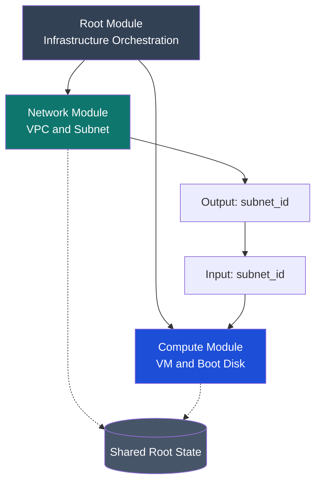
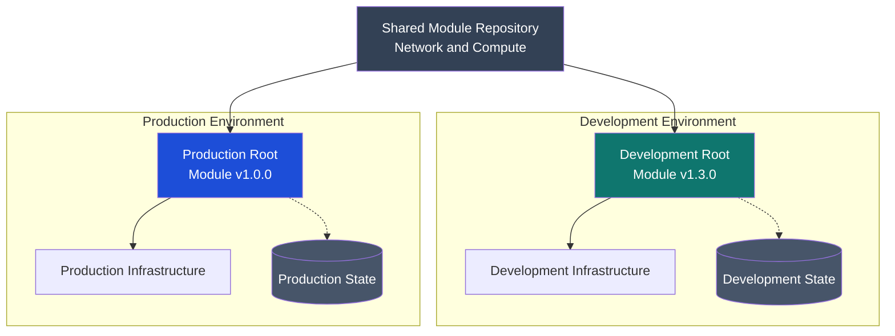
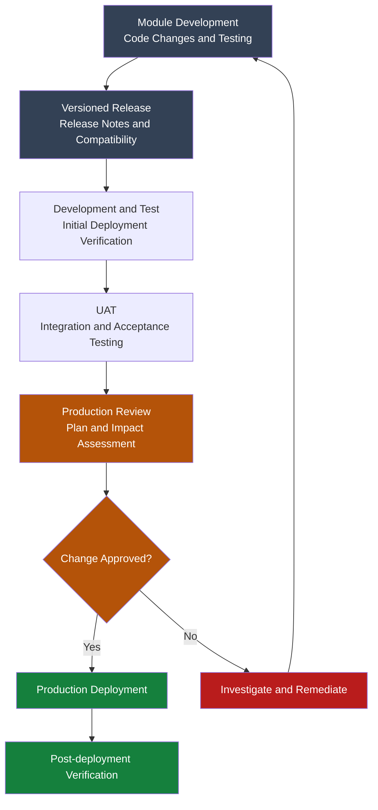

## Diagram 1 — Module Composition

### Key Learning Points

- The root module orchestrates infrastructure components.
- The network module exposes the subnet ID.
- The compute module consumes the subnet ID.
- Output-to-input references create implicit dependencies.
- Both child modules share the root module's Terraform state.

## Diagram 2 — Reusable Modules and State Isolation

### Key Learning Points

- Multiple environments can consume the same module code.
- Each environmentas an independent root configuration.
- Each environment uses a distinct state location.
- Environments can consume different module versions.
- Development changes do not automatically propagate to Production.
- State isolation helps reduce deployment blast radius.

## Diagram 3 — Safe Module Release Promotion

### Key Learning Points

- Module releases should be versioned.
- Changes should be tested in lower environments.
- Production requires an environment-specific Terraform plan.
- tomated tests do not replace engineering approval.
- Unacceptable changes must be investigated before deployment.
- Post-deployment verification is part of the change lifecycle.
