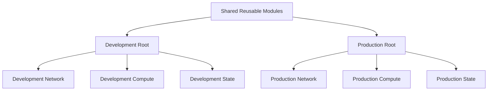
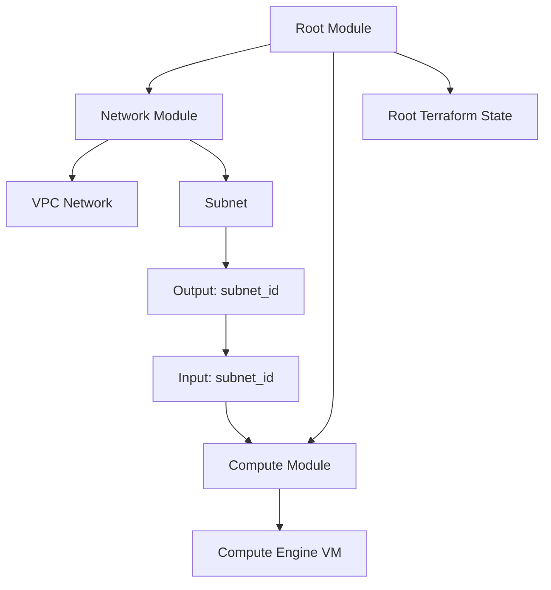
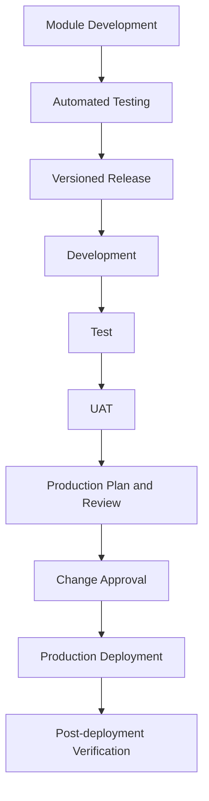
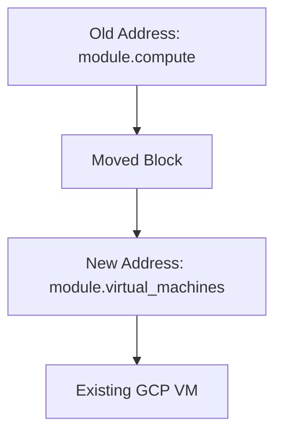
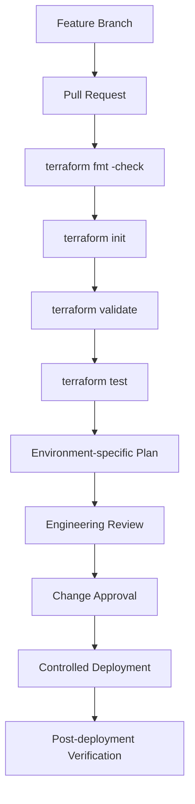
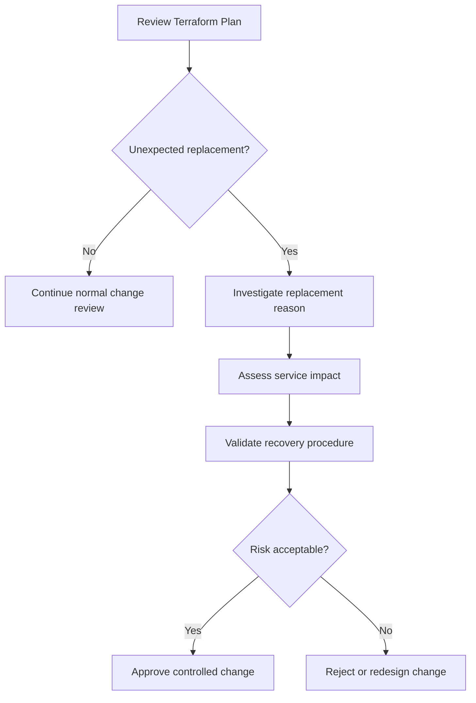

# Module 8 — Terraform Modules

## 1. Overview

Terraform modules provide a mechanism for organising, encapsulating,
standardising and reusing Infrastructure as Code (IaC).

Rather than duplicating resource configurations across multiple environments
or engineering teams, modules allow infrastructure components to be defined
once and consumed through well-defined interfaces.

Modules are a fundamental building block of scalable infrastructure platforms
and are particularly important in enterprise, multi-environment and
production cloud architectures.

### 1.1 Learning Objectives

- Understand the purpose and architecture of Terraform modules.
- Differentiate between root and child modules.
- Understand module composition and dependencies.
- Design reusable and maintainable module interfaces.
- Understand module sources and versioning.
- Understand the relationship between modules and Terraform state.
- Implement environment isolation.
- Understand module testing and validation.
- Safely upgrade and refact Terraform modules.
- Understand the operational risks of shared infrastructure modules.
- Apply production engineering and security best practices.

---

## 2. Core Concepts


### 2.1 What Is a Terraform Module?

A Terraform module is a collection of Terraform configuration files within
a directory that are evaluated together.

Every Terraform configuration has at least one module: the root module.

Modules can contain:

- Resources
- Data sources
- Input variables
- Output values
- Local values
- Provider requirements
- Child module calls
- Validation and lifecycle configuration

Modules provide logical boundaries within infrastructure code but do not
automatically provide independent deployment or state boundaries.

### 2.2 Root Module

The root module is the entry point of a Terraform configuration.

It is normally the working directory from which Terraform commands are
executed.

Responsibilities include:

- Configuring providers.
- Configuring the state backend.
- Defining environment-specific configuration.
- Calling child modules.
- Passing input values to child modules.
- Connecting child module outputs to other module inputs.
- Orchestrating infrastructure dependencies.
- Exposing root-level outputs.

The root module represents the primary configuration boundary for a
Terraform deployment.

### 2.3 Child Module

A child module is a module called by another Terraform module.

Child modules encapsulate reusable infrastructure functionality.

Examples include:

- VPC networking modules.
- Compute Engine modules.
- Firewall modules.
- Kubernetes modules.
- Load balancing modules.
- Database modules.
- IAM modules.
- Monitoring modules.

Child modules can also call other child modules.

Resources created by child modules are normally managed within the state
of their calling root configuration.

### 2.4 Root vs Child Modules

| Characteristic | Root Module | Child Module |
|---|---|---|
| Primary purpose | Infrastructure orchestration | Reusable infrastructure functionality |
| Entry point | Yes | No |
| Backend configuration | Defined here | Uses root deployment context |
| Independent state | Can have its own state | Normally shares root state |
| Provider configuration | Normally defined here | Receives provider configurations |
| Provider requirements | Declares required providers | Declares its own provider requirements |
| Environment-specific values | Typically supplied here | Received through inputs |
| Reusability | Environment-specific | Designed for reuse |

### 2.5 Module Reusability

A reusable module allows the same infrastructure configuration to be
deployed multiple times using different input values.

For example, a compute module could be consumed by multiple engineering
teams within a trading organisation.

| Engineering Team | Example Infrastructure | Module Used |
|---|---|---|
| Market Data | Market data processing VMs | Compute module |
| Trade Execution | Order execution VMs | Compute module |
| Risk Management | Risk calculation VMs | Compute module |
| Monitoring | Monitoring infrastructure | Compute module |
| Development | Application testing VMs | Compute module |

Each consumer can provide different machine types, instance names,
subnets and other supported configuration values without duplicating
the underlying resource definitions.

Reusing module code does not mean sharing the same infrastructure
resources or Terraform state.

---

## 3. Module Architecture

### 3.1 Recommended Directory Structure

Example GCP infrastructure platform:

```text
terraform/
└── gcp-platform/
    ├── environments/
    │   ├── dev/
    │   │   ├── main.tf
    │   │   ├── providers.tf
    │   │   ├── versions.tf
    │   │   ├── variables.tf
    │   │   ├── outputs.tf
    │   │   └── backend.tf
    │   ├── test/
    │   ├── uat/
    │   └── prod/
    └── modules/
        ├── network/
        │   ├── main.tf
        │   ├── variables.tf
        │   ├── outputs.tf
        │   └── versions.tf
        └── compute/
            ├── main.tf
            ├── variables.tf
            ├── outputs.tf
            └── versions.tf
```

The environments directory contains independent root configurations.

The modules directory contains reusable infrastructure components.

Each environment can consume the same modules while supplying its own
configuration values and using an independent state location.

### 3.2 Environment Isolation

Separate root configurations can provide independent infrastructure
deployment boundaries.



Benefits include:

- Reduced deployment blast radius.
- Independent environment lifecycle.
- Separate state locking.
- Environment-specific permissions.
- Independent module upgrades.
- Reduced risk of accidental production changes.

### 3.3 Shared Modules vs Shared State

| Architecture | Module Code | State |
|---|---|---|
| One root calling multiple child modules | Reusable | Shared root state |
| Multiple independent root configurations | Reusable | Independent if configured correctly |
| Development and Production using the same module | Shared code | Can be independently managed |
| Multiple roots using the same backend state location | Reusable | Shared state location |

Separate directories alone do not guarantee state isolation.

Backend configurations must reference distinct state locations.

A root module calling multiple child modules does not automatically
create multiple state files.

---

## 4. Module Interfaces

### 4.1 Input Variables

Input variables allow consumers to provide configuration values to
a module.

Example:

```hcl
variable "machine_type" {
  description = "Compute Engine machine type"
  type        = string
  default     = "e2-medium"
}
```

The calling module supplies the value:

```hcl
module "compute" {
  source       = "../../modules/compute"
  machine_type = "e2-standard-2"
}
```

Input variables form part of a module's public interface.

### 4.2 Output Values

Outputs expose selected information from a module to its caller.

Example:

```hcl
output "subnet_id" {
  description = "ID of the created subnet"
  value       = google_compute_subnetwork.main.id
}
```

The root module can reference the output using:

```hcl
module.network.subnet_id
```

Outputs allow modules to exchange information without exposing their
complete internal implementation.

### 4.3 Input Validation

Input validation allows modules to reject unsupported or invalid
configuration values.

```hcl
variable "environment" {
  description = "Deployment environment"
  type        = string

  validation {
    condition = contains(
      ["dev", "test", "uat", "prod"],
      var.environment
    )

    error_message = "Unsupported environment."
  }
}
```

Validation improves consistency and helps identify configuration
errors before deployment.

### 4.4 Module Interface Design

A well-designed module should expose only the inputs and outputs
required by its consumers.

Exposing every possible resource attribute can introduce:

- Excessive complexity.
- Increased maintenance requirements.
- Inconsistent infrastructure builds.
- Security configuration drift.
- Greater testing requirements.

Modules should provide sensible defaults, enforce appropriate security
baselines and allow flexibility where justified.

### 4.5 Example Compute Module Interface

| Input | Type | Purpose |
|---|---|---|
| instance_name | string | Name of the VM |
| machine_type | string | Compute Engine machine type |
| zone | string | Deployment zone |
| subnet_id | string | Subnet used by the VM |

| Output | Purpose |
|---|---|
| instance_id | Identifies the deployed VM |
| internal_ip | Exposes the VM internal IP address |

The module interface should remain as simple as possible while
satisfying legitimate consumer requirements.

---

## 5. Module Composition and Dependencies

### 5.1 Module Composition

Module composition is the process of combining multiple reusable
modules to build a larger infrastructure platform.

The root module coordinates the individual components.

Example:

```hcl
module "network" {
  source       = "../../modules/network"
  network_name = "atlas-dev-vpc"
  subnet_name  = "atlas-dev-subnet"
  subnet_cidr  = "10.10.10.0/24"
  region       = "europe-west2"
}

module "compute" {
  source        = "../../modules/compute"
  instance_name = "atlas-dev-vm"
  machine_type  = "e2-medium"
  zone          = "europe-west2-a"
  subnet_id     = module.network.subnet_id
}
```

The network module creates the network and subnet.

The compute module receives the subnet ID through its input interface.

The root module acts as the orchestrator.

### 5.2 Module Composition Diagram



### 5.3 Implicit Dependencies

Terraform automatically identifies dependencies created through
references between resources and module outputs.

```hcl
subnet_id = module.network.subnet_id
```

This creates an implicit dependency on the network module's subnet
output.

Terraform uses its dependency graph to determine the appropriate
execution order.

An explicit `depends_on` is not required for this relationship.

### 5.4 Explicit Dependencies

Explicit dependencies can be declared using:

```hcl
depends_on = [module.network]
```

This is appropriate when a dependency exists that Terraform cannot
infer from configuration references.

Explicit dependencies should not be used unnecessarily because they
can introduce overly conservative planning and reduce execution
parallelism.

### 5.5 Implicit vs Explicit Dependencies

| Characteristic | Implicit Dependency | Explicit Dependency |
|---|---|---|
| Detection | Automatically inferred | Manually declared |
| Configuration | Resource or output reference | depends_on |
| Preferred approach | Yes | Only when necessary |
| Example | module.network.subnet_id | depends_on = [module.network] |
| Primary benefit | Natural dependency relationships | Handles hidden dependencies |

### 5.6 Loose Coupling

Modules should be designed to minimise dependencies on each other's
internal implementation.

The compute module should not need to understand how the network
module creates a subnet.

It only needs to receive a valid subnet ID.

This allows the compute module to consume:

- A subnet created by another module.
- An existing subnet.
- A subnet managed by a separate infrastructure deployment.

Loose coupling improves maintainability, portability, testability
and reuse.

---

## 6. Module Sources and Versioning

### 6.1 Local Module Sources

Modules can be referenced from local directories.

```hcl
module "compute" {
  source = "../../modules/compute"
}
```

Local modules are useful for development, learning and infrastructure
components maintained within the same repository.

Local module sources do not support the registry `version` argument.

### 6.2 Git Module Sources

Modules can be stored in independent Git repositories.

```hcl
module "compute" {
  source = "git::https://github.com/AtlasEngineeringLabs/terraform-gcp-compute.git?ref=v1.0.0"
}
```

The repository address above is illustrative.

Git references can include:

- Tags
- Branches
- Commit hashes

Production consumers should avoid relying on mutable development
branches.

Protected release tags or immutable commit references provide more
predictable module consumption.

### 6.3 Terraform Registry Modules

Modules can also be consumed from public or private Terraform
registries.

```hcl
module "network" {
  source  = "terraform-google-modules/network/google"
  version = "X.Y.Z"
}
```

The version above is a placeholder for a verified module release.

Registry modules support version constraints through the `version`
argument.

### 6.4 Module Source Comparison

| Source | Example | Typical Use |
|---|---|---|
| Local directory | ../../modules/compute | Development and monorepos |
| Git repository | git::https://github.com/example/repo.git | Centrally managed modules |
| Public registry | terraform-google-modules/network/google | Community modules |
| Private registry | Organisation-specific registry | Enterprise module distribution |

### 6.5 Semantic Versioning

Semantic Versioning uses the following format:

```text
MAJOR.MINOR.PATCH
```

| Version Component | Purpose | Example |
|---|---|---|
| MAJOR | Breaking interface or compatibility changes | 1.0.0 to 2.0.0 |
| MINOR | Backwards-compatible functionality | 1.0.0 to 1.1.0 |
| PATCH | Backwards-compatible fixes | 1.0.0 to 1.0.1 |

Semantic versioning communicates the intended compatibility of
a release.

It does not guarantee that a module upgrade will avoid infrastructure
replacement.

All upgrades must be evaluated through an environment-specific
Terraform plan.

### 6.6 Independent Environment Versioning


Different environments can consume different module versions.

| Environment | Compute Module Version |
|---|---|
| Development | v1.3.0 |
| Test | v1.2.0 |
| UAT | v1.1.0 |
| Production | v1.0.0 |

Publishing a new module release does not automatically upgrade
environments pinned to an existing version.

The consumer must explicitly update its version or Git reference
and initialise the updated configuration.

This supports controlled release promotion.

### 6.7 Provider Versions vs Module Versions

Provider versions and module versions are separate dependency
management concepts.

```hcl
terraform {
  required_providers {
    google = {
      source  = "hashicorp/google"
      version = "~> 6.0"
    }
  }
}
```

This illustrative provider constraint permits 6.x releases but
excludes 7.x.

The `.terraform.lock.hcl` file records selected provider versions
and checksums.

It does not lock remote module versions.

Module versions must be controlled through their source references
or registry version constraints.

| Dependency | Version Management | Recorded in Lock File |
|---|---|---|
| Terraform CLI | required_version | No |
| Terraform provider | required_providers | Yes |
| Registry module | version argument | No |
| Git module | Git ref | No |
| Local module | Local source code | No |

---

## 7. Module Lifecycle

### 7.1 Terraform Initialisation

The `terraform init` command prepares a Terraform working directory.

Its responsibilities include:

- Initialising the configured backend.
- Discovering child modules.
- Installing remote modules.
- Resolving provider dependencies.
- Installing required providers.
- Creating or updating the provider dependency lock file.

Terraform initialisation does not deploy infrastructure.

After changing a module source or version, the configuration should
be reinitialised.

### 7.2 Module Upgrade Process

A controlled module upgrade should include:

1. Review the module release notes.
2. Review compatibility and breaking changes.
3. Update the module version or source reference.
4. Run Terraform initialisation.
5. Validate the configuration.
6. Execute relevant module tests.
7. Generate an environment-specific Terraform plan.
8. Review resource changes and dependencies.
9. Assess operational impact.
10. Obtain the appropriate approval.
11. Apply the reviewed change.
12. Verify infrastructure and application health.

### 7.3 Controlled Release Promotion



Module upgrades should normally progress through lower environments
before being introduced into Production.

---

## 8. Terraform Modules and State

### 8.1 Resource Addresses

Terraform identifies managed infrastructure through resource addresses
recorded in state.

Example:

```text
module.compute.google_compute_instance.main
```

| Address Component | Meaning |
|---|---|
| module.compute | Module call address |
| google_compute_instance | Resource type |
| main | Resource name |

The module source path alone does not determine the resource's
identity in Terraform state.

### 8.2 Renaming Modules

Original configuration:

```hcl
module "compute" {
  source = "../../modules/compute"
}
```

Updated configuration:

```hcl
module "virtual_machines" {
  source = "../../modules/compute"
}
```

Although the source module remains unchanged, the resource address
changes.

```text
Old address:
module.compute.google_compute_instance.main

New address:
module.virtual_machines.google_compute_instance.main
```

Without an appropriate migration, Terraform may propose destroying
resources at the old address and creating resources at the new address.

### 8.3 Moved Blocks

A `moved` block allows Terraform resource addresses to be refactored
without unnecessarily recreating existing infrastructure.

```hcl
moved {
  from = module.compute
  to   = module.virtual_machines
}
```

Terraform can associate the existing resources with their new addresses.

If no other infrastructure changes are required, the resources can
remain in place.

Benefits include:

- Declarative state migration.
- Version-controlled refactoring.
- Improved change visibility.
- Reviewable migration history.
- Consistent migration across environments.

Moved blocks do not prevent replacements caused by unrelated resource
configuration changes.

### 8.4 Module Refactoring Diagram



The existing cloud resource remains associated with Terraform state
through its updated address.

### 8.5 Terraform State Move

The equivalent imperative operation can be performed using:

```bash
terraform state mv \
  module.compute \
  module.virtual_machines
```

This directly changes the state mapping.

Moved blocks are generally preferable for planned, version-controlled
refactoring.

State manipulation commands require careful coordination, particularly
when working with shared remote state.

### 8.6 Moved Block vs State Move

| Characteristic | Moved Block | terraform state mv |
|---|---|---|
| Approach | Declarative | Imperative |
| Defined in Terraform code | Yes | No |
| Version-controlled migration | Yes | Not automatically |
| Visible during code review | Yes | Not automatically |
| State modification | During apply | Direct |
| Preferred for planned refactoring | Generally yes | Situational |

---

## 9. Module Testing and Validation

### 9.1 Terraform Testing Commands

| Command | Purpose |
|---|---|
| terraform fmt -check | Verify formatting consistency |
| terraform validate | Verify syntax and internal configuration consistency |
| terraform plan | Evaluate proposed infrastructure changes |
| terraform test | Execute defined Terraform tests and assertions |

These commands provide different levels of assurance.

A successful validation does not guarantee a safe deployment.

A successful plan does not guarantee a successful apply.

Successful module tests do not guarantee that an existing production
deployment can be upgraded without disruption.

### 9.2 Validation vs Planning vs Testing

| Capability | Validate | Plan | Test |
|---|---|---|---|
| Check configuration syntax | Yes | Yes | Yes |
| Evaluate infrastructure changes | No | Yes | Depends on test |
| Execute custom assertions | No | Not its primary purpose | Yes |
| Create infrastructure | No | No | Apply-based tests can |
| Guarantee production safety | No | No | No |

### 9.3 Native Terraform Tests

Terraform supports native test files using the `.tftest.hcl` extension.

Example:

```hcl
run "verify_machine_type" {
  command = plan

  variables {
    instance_name = "test-vm"
    machine_type  = "e2-medium"
    zone          = "europe-west2-a"
    subnet_id     = "projects/test-project/regions/europe-west2/subnetworks/test-subnet"
  }

  assert {
    condition = (
      google_compute_instance.main.machine_type == "e2-medium"
    )

    error_message = "Incorrect VM machine type."
  }
}
```

This illustrative test assumes the module exposes the specified
inputs and contains the referenced resource.

Run the tests using:

```bash
terraform test
```

Plan-based tests evaluate configuration without applying the planned
resources, although they may still contact provider APIs.

Apply-based tests can provision real infrastructure and therefore
introduce cloud costs and cleanup requirements.

### 9.4 Recommended Test Categories

| Category | Example |
|---|---|
| Input validation | Reject invalid environment names |
| Resource configuration | Verify machine type |
| Networking | Verify subnet assignment |
| Security | Verify external IPs are disabled by default |
| Standardisation | Verify required resource labels |
| Outputs | Verify expected module output values |
| Integration | Verify infrastructure components work together |
| Upgrade testing | Identify unexpected resource replacement |

Upgrade safety requires testing against an appropriate existing
deployment or state, not simply creating new infrastructure from
scratch.

### 9.5 CI/CD Integration

A production-oriented Terraform validation pipeline could follow
this sequence:



Automated checks should complement engineering review rather than
replace it.

---

## 10. Production Safety and Change Management

### 10.1 Understanding Terraform Plan Actions

| Symbol | Meaning |
|---|---|
| + | Create resource |
| - | Destroy resource |
| ~ | Update resource in place |
| -/+ | Destroy and then create replacement |
| +/- | Create replacement and then destroy original |

Resource replacement can cause service disruption, data loss or
changes to dependent infrastructure.

### 10.2 Production Upgrade Checklist

Before approving a production module upgrade, establish:

- What has changed between module versions.
- Whether inputs and outputs remain compatible.
- Whether provider requirements have changed.
- Whether resource addresses have changed.
- Whether automated tests have passed.
- Whether Development and UAT testing has completed.
- Whether the production plan proposes resource replacement.
- Which applications and services are affected.
- Whether redundancy and failover are available.
- Whether backups and recovery procedures exist.
- Whether a maintenance window is required.
- Whether monitoring and post-deployment verification are ready.

### 10.3 Rollback Considerations

Reverting a Git commit does not necessarily restore previously
destroyed infrastructure.

A production recovery plan must consider:

- Infrastructure state.
- Application state.
- Persistent data.
- Backup restoration.
- Network connectivity.
- Service dependencies.
- Recovery time requirements.

Rollback procedures must address the actual infrastructure and
workload, not just the Terraform configuration.

### 10.4 Production Change Decision Process



---

## 11. Centralised Module Management

### 11.1 Modules as Internal Infrastructure Products

A centrally maintained Terraform module should be treated as an
internal infrastructure product.

It should have:

- Defined ownership.
- Documented interfaces.
- Version management.
- Automated testing.
- Security standards.
- Release notes.
- Change management.
- Support and maintenance processes.
- A deprecation strategy.

### 11.2 Benefits and Trade-offs

| Benefits | Trade-offs |
|---|---|
| Standardised infrastructure | Dependency on central maintainers |
| Consistent security baseline | Reduced flexibility for specialist workloads |
| Reduced code duplication | Shared defects can affect multiple consumers |
| Centralised improvements | Release coordination requirements |
| Consistent monitoring and labels | Potential engineering bottlenecks |
| Centralised testing | Increased responsibility for maintainers |

Centralised modules are generally preferable to independently
maintained copies of equivalent infrastructure code.

However, specialist workloads may justify dedicated modules.

For example, a latency-sensitive Market Data workload may have
networking and compute requirements that are inappropriate for a
general-purpose application VM module.

### 11.3 When to Create a Reusable Module

| Create a Module When | Avoid Creating a Module When |
|---|---|
| Infrastructure is repeatedly deployed | Abstraction provides no meaningful benefit |
| A consistent security baseline is required | A simple resource is unnecessarily wrapped |
| Multiple teams require the same capability | The interface is excessively complicated |
| Infrastructure has a clear responsibility | The module has no clear responsibility |
| Independent versioning provides value | Maintenance outweighs reuse benefits |

---

## 12. Security Best Practices

- Use secure configuration defaults.
- Expose only necessary configuration inputs.
- Avoid embedding credentials within modules.
- Avoid committing secrets or Terraform state files.
- Use appropriate IAM permissions.
- Use dedicated workload identities for production automation.
- Restrict access to remote state.
- Review external modules before adoption.
- Pin production module versions.
- Test security-related module changes.
- Avoid exposing unnecessary sensitive outputs.
- Maintain clear module ownership and review processes.

> **Important:** Marking a Terraform value as sensitive reduces its
> visibility in normal CLI output but does not automatically remove
> it from Terraform state.

---

## 13. Practical Engineering Scenarios

### 13.1 Scenario 1 — Multi-environment Infrastructure

**Requirement**

Deploy equivalent networking and compute infrastructure across
Development, Test, UAT and Production.

**Recommended Approach**

Use independent environment root configurations that consume shared
reusle child modules.

Each environment must have an independent state location.

**Benefits**

- Consistent infrastructure architecture.
- Independent deployment lifecycle.
- Reduced blast radius.
- Controlled module upgrades.

### 13.2 Scenario 2 — Network and Compute Dependencies

**Requirement**

A Compute Engine VM must be deployed into a subnet created by a
separate network module.

**Recommended Approach**

Expose the subnet ID through the network module's outputs and pass
it into the compute module through the root configuration.

```hcl
subnet_id = module.network.subnet_id
```

This creates an implicit dependency and maintains loose coupling.

### 13.3 Scenario 3 — Production Module Upgrade

**Requirement**

A shared compute module receives a security update.

Development successfully adopts the new release.

Production remains pinned to the previous release.

**Recommended Approach**

- Review the release notes.
- Review compatibility.
- Validate the module in lower environments.
- Update the production module reference.
- Generate a production-specific plan.
- Assess operational impact.
- Obtain appropriate approval.

### 13.4 Scenario 4 — Unexpected VM Replacement

**Requirement**

A compute module upgrade proposes replacing three production VMs.

Automated validation and testing have passed.

**Recommended Approach**

Do not approve the change until the following have been assessed:

- Replacement reason.
- Affected applications and services.
- Service availability requirements.
- Redundancy and failover.
- Maintenance requirements.
- Backup and recovery procedures.

Successful automated tests do not remove the need for operational
impact assessment.

### 13.5 Scenario 5 — Module Refactoring

**Requirement**

Rename the compute module to virtual_machines without recreating
its existing infrastructure.

**Recommended Approach**

```hcl
moved {
  from = module.compute
  to   = module.virtual_machines
}
```

Review the Terraform plan to confirm that the existing resources
are recognised at their new addresses.

### 13.6 Scenario 6 — Enterprise Module Standardisation

**Requirement**

Twelve engineering teams deploy similar GCP infrastructure.

**Recommended ApproachProvide centrally maintained, tested and versioned modules.

Allow teams to consume approved versions independently while
maintaining a consistent security and infrastructure baseline.

Consider specialist modules where justified by workload requirements.

---

## 14. Common Mistakes and Anti-patterns

| Mistake | Consequence | Recommended Approach |
|---|---|---|
| Duplicating module code | Configuration drift | Reuse centrally maintained modules |
| Exposing every resource attribute | Excessive complexity | Define purposeful interfaces |
| Hardcoding environment values | Reduced reusability | Use input variables |
| Referencing sibling module internals | Invalid references and tight coupling | Use outputs and inputs |
| Excessive depends_on usage | Overly conservative planning | Prefer implicit dependencies |
| Assuming child modules have independent state | Incorrect deployment boundaries | Use independent root configurations |
| Sharing backend state locations | State conflicts and increased risk | Configure distinct state locations |
| Using mutable Git branches in Production | Unpredictable changes | Pin stable releases or commits |
| Assuming the lock file pins modules | Uncontrolled module resolution | Explicitly constrain module versions |
| Renaming modules without migration | Unexpected destruction and creation | Use moved blocks |
| Treating validation as deployment approval | Unexpected infrastructure changes | Review environment-specific plans |
| Assuming tests guarantee upgrade safety | Production disruption | Perform upgrade-specific testing |
| Running apply-based tests without cost controls | Unexpected cloud charges | Use isolated test environments |
| Assuming Git rollback restores infrastructure | Incomplete recovery | Prepare infrastructure and data recovery |
| Creating modules without clear purpose | Unnecessary abstraction | Define meaningful responsibilities |

---


## 15. Key Terminology

| Term | Definition |
|---|---|
| Module | Collection of Terraform configuration files evaluated together |
| Root Module | Entry point of a Terraform configuration |
| Child Module | Module called by another module |
| Module Interface | Public inputs and outputs exposed to consumers |
| Module Composition | Combining modules to build larger infrastructure |
| Encapsulation | Hiding internal implementation behind a defined interface |
| Loose Coupling | Minimising dependencies on internal implementations |
| Implicit Dependency | Dependency inferred from configuration references |
| Explicit Dependency | Dependency declared using depends_on |
| Dependency Graph | Terraform representation of resource relationships |
| Module Source | Location from which a module is obtained |
| Version Pinning | Restricting a dependency to a specified release or reference |
| Semantic Versioning | MAJOR.MINOR.PATCH release convention |
| Resource Address | Terraform identifier for a resource or resource instance |
| Moved Block | Declarative resource-address migration |
| Refactoring | Restructuring code without intending to change infrastructure behaviour |
| Assertion | Test condition that must evaluate successfully |
| Integration Testing | Testing interactions between infrastructure components |
| Blast Radius | Potential scope of impact caused by a change or failure |
| Security Baseline | Minimum standard security configuration |
| Release Promotion | Controlled adoption of releases across environments |

---

## 16. Things to Remember

1. Every Terraform configuration has a root module.
2. A module is a code abstraction, not automatically a state boundary.
3. Child modules normally share their calling root's state.
4. Reusing module code does not mean sharing infrastructure.
5. Separate root configurations require distinct state locations.
6. The root module orchestrates child module relationships.
7. Inputs and outputs form a module's public interface.
8. Output-to-input references create implicit dependencies.
9. Module sources and module call names serve different purposes.
10. Production module versions should be explicitly controlled.
11. Provider dependency locking does not lock remote modules.
12. Semantic versioning does not guarantee non-destructive upgrades.
13. Renaming a module can change resource addresses.
14. Moved blocks support declarative address migrations.
15. Validation does not guarantee deployment safety.
16. Module tests and production plans provide different assurance.
17. Resource replacement requires operational impact assessment.
18. Reverting code does not necessarily restore destroyed infrastructure.
19. Shared modules require ownership, testing and release governance.
20. Modules should balance standardisation with justified flexibility.

---

## 17. Useful Commands

| Command | Purpose |
|---|---|
| terraform init | Initialise backend, providers and modules |
| terraform init -upgrade | Re-evaluate eligible provider and module versions |
| terraform get | Download referenced modules |
| terraform get -update | Update downloaded modules |
| terraform fmt -recursive | Format configuration files recursively |
| terraform fmt -check -recursive | Check formatting |
| terraform validate | Validate configuration |
| terraform plan | Preview infrastructure changes |
| terraform test | Execute Terraform tests |
| terraform graph | Generate dependency graph representation |
| terraform state list | List managed resource addresses |
| terraform state show ADDRESS | Inspect a resource recorded in state |
| terraform state mv SOURCE DESTINATION | Move a resource or module state mapping |
| terraform providers | Display provider requirements |

Commands that modify state or upgrade dependencies should be
executed with appropriate review and coordination.

---

## 18. Revision Checklist

### 18.1 Module Fundamentals

- [ ] Explain the purpose of Terraform modules.
- [ ] Differentiate between root and child modules.
- [ ] Explain the relationship between modules and state.
- [ ] Explain the benefits of reusable modules.

### 18.2 Architecture and Composition

- [ ] Design a reusable network module.
- [ ] Design a reusable compute module.
- [ ] Explain module input and output interfaces.
- [ ] Explain implicit and explicit dependencies.
- [ ] Explain loose coupling.
- [ ] Design independent environment state boundaries.

### 18.3 Versioning and Lifecycle

- [ ] Explain local, Git and registry module sources.
- [ ] Explain semantic versioning.
- [ ] Explain module version pinning.
- [ ] Differentiate between provider and module versions.
- [ ] Describe a controlled production module upgrade.

### 18.4 State and Refactoring

- [ ] Interpret a Terraform resource address.
- [ ] Explain the impact of renaming a module.
- [ ] Write a moved block.
- [ ] Explain moved blocks versus terraform state mv.

### 18.5 Testing and Production Safety

- [ ] Differentiate between validate, plan and test.
- [ ] Explain native Terraform test assertions.
- [ ] Interpret Terraform plan action symbols.
- [ ] Assess the risks of resource replacement.
- [ ] Explain production approval and rollback requirements.
- [ ] Explain centralised module management trade-offs.

### 18.6 Practical Competency — Pending Capstone

- [ ] Build reusable GCP network and compute modules.
- [ ] Connect modules using inputs and outputs.
- [ ] Configure a remote state backend.
- [ ] Implement module tests.
- [ ] Deploy and verify GCP infrastructure.
- [ ] Perform controlled infrastructure changes.
- [ ] Safely tear down deployed resources.

---

## 19. Typical Interview Questions

Detailed questions and model answers should be maintained in the
existing Terraform interview notes document.

The following questions provide a quick revision reference.

### Foundation Questions

1. What is a Terraform module?
2. What is the difference between a root module and a child module?
3. Do Terraform child modules have separate state files?
4. How do Terraform modules communicate?
5. How does Terraform determine dependencies between modules?
6. What is loose coupling in Terraform module design?
7. When should you create a reusable Terraform module?

### Architecture Questions

8. How would you structure Terraform for multiple environments?
9. How would you reduce the blast radius of a Terraform deployment?
10. Can separate Terraform root configurations exchange information?
11. What are the benefits of centrally maintained Terraform modules?
12. Should a reusable module expose every possible resource attribute?
13. How would you design a Terraform module for a trading platform?

### Versioning and Lifecycle Questions

14. How do you version Terraform modules?
15. Does releasing a new module version automatically update Production?
16. Does the Terraform dependency lock file lock module versions?
17. How would you safely upgrade a production Terraform module?

### State and Refactoring Questions

18. What happens if you rename a Terraform module?
19. How can you rename a module without recreating its infrastructure?
20. What is the difference between a moved block and terraform state mv?

### Testing and Production Safety Questions

21. What is the difference between terraform validate, plan and test?
22. Can a Terraform module test create real cloud resources?
23. What does -/+ mean in a Terraform plan?
24. Would you approve a production plan that replaces three VMs if
    all automated tests passed?
25. Why is reverting Terraform code not always sufficient for rollback?

---

## 20. Engineering Principles

| Preferred Approach | Avoid |
|---|---|
| Reusability | Unnecessary duplication |
| Explicit interfaces | Hidden dependencies |
| Loose coupling | Tight coupling |
| Secure defaults | Unrestricted flexibility |
| Declarative configuration | Unnecessary manual state manipulation |
| Controlled releases | Uncontrolled upgrades |
| Environment isolation | Unnecessary shared deployment boundaries |
| Evidence-based approval | Assumptions |
| Operational resilience | Deployment convenience |
| Simplicity | Unnecessary abstraction |

---

## 21. Official Reference Material

- [Terraform Modules](https://developer.hashicorp.com/terraform/language/modules)
- [Module Sources](https://developer.hashicorp.com/terraform/language/modules/sources)
- [Module Composition](https://developer.hashicorp.com/terraform/language/modules/develop/composition)
- [Module Refactoring](https://developer.hashicorp.com/terraform/language/modules/develop/refactoring)
- [Terraform Testing](https://developer.hashicorp.com/terraform/language/tests)
- [Terraform State](https://developer.hashicorp.com/terraform/language/state)
- [Dependency Lock File](https://developer.hashicorp.com/terraform/language/files/dependency-lock)
- [Terraform CLI Commands](https://developer.hashicorp.com/terraform/cli/commands)
- [Semantic Versioning](https://semver.org/)

---

## 22. Module Completion Status

| Component | Status |
|---|---|
| Lesson 1 — Root and Child Modules | Complete |
| Lesson 2 — Module Composition and Dependencies | Complete |
| Lesson 3 — Module Design, VersioninProduction Safety | Complete |
| Lesson 4 — Module Lifecycle, Testing and Refactoring | Complete |
| Knowledge Checks | Complete |
| Module 8 Theory | Complete |
| GCP Foundation and Workstation Preparation | Complete |
| Practical Module Implementation | Pending Capstone |

**Theory completion date:** 4 November 2026

**Next stage:** Terraform Capstone 1 — GCP Infrastructure Platform.

The next stage is to apply these concepts by buig, testing,
deploying and managing a reusable GCP infrastructure platform.

---

## Architecture Revision Diagrams

The following diagrams provide a visual reference for the core
architectural concepts covered in Module 8.

| Diagram | Description |
|---|---|
| [Module Composition](diagrams/module-8-architecture-diagrams.md#diagram-1--module-composition) | Root and child module relationships |
| [Reusable Modules and State Isolation](diagrams/module-8-architecture-diagrams.md#diagram-2--reusable-modules-and-state-isolation) | Independent environment deployment boundaries |
| [Safe Module Release Promotion](diagrams/module-8-architecture-diagrams.md#diagram-3--safe-module-release-promotion) | Controlled production module upgrades |
